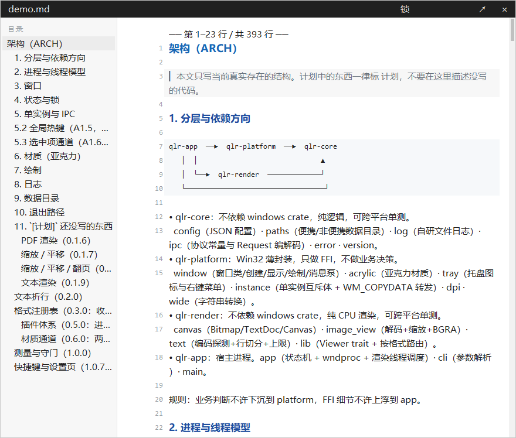

# QLRust

用 Rust 重写的 Windows「按空格预览」工具，思路与交互对齐 [QuickLook](https://github.com/QL-Win/QuickLook)，目标是把**冷启动、首帧、内存、分发体积**全部压下一个数量级。

> 当前版本 **1.8.2**（Windows 10 / 11 x64，GPL-3.0-or-later，见 [LICENSE](LICENSE) 与 [NOTICE.md](NOTICE.md)）。
> 内置 **11 类**查看器：**图片 · PDF · 文本 · 源码 · Markdown · Office · 压缩包 · 音频 · 视频 · SVG · HTML**；其余格式以**插件**（进程内 C ABI）形式接入。
> 接手开发先读 [docs/dev/HANDOFF.md](docs/dev/HANDOFF.md)，再看 [docs/dev/ARCH.md](docs/dev/ARCH.md) 与 [docs/dev/STATUS.md](docs/dev/STATUS.md)。



## 支持什么

| 类别 | 覆盖 | 能力 |
|---|---|---|
| 图片 | png jpg jpeg jfif gif bmp dib webp tif tiff ico cur | 按原图尺寸的 **50%** 开窗（设置页可改 10–400%）、左键拖动移动窗口、滚轮缩放、大图按预算降采样 |
| PDF | pdf | 逐页渲染、**顶栏页码框（点了可输入页码直接跳）**、**页缓存（翻回去 0 ms，顺带预取前后各一页）**、滚轮上下滑动/到边翻页、左键拖动移动窗口、缩小态超采样不糊 |
| 文本 | txt log ini toml yaml json xml csv（共 100+ 扩展名） | 编码自动识别、自动折行、**每行左侧行号**、滚轮/右键拖动/翻页滚动、只画可视区、默认 880 px 阅读宽度 |
| 源码 | rs go py js ts c cpp java cs php rb lua sh ps1 sql json toml yaml 等 70+ | **仿 VSCode**：等宽字体 + 行号 + 关键字/字符串/注释/数字着色，不折行、超长行截断 |
| Markdown | md markdown mdown mkd mkdn | 标题分级、代码块、引用、列表、任务框、表格、分隔线着色；行内标记**渲染后去掉**（不是源码）；**左侧目录**（点击跳转、高亮跟随滚动） |
| Office | docx xlsx pptx pptm potx ppsx odt ods odp | **交给系统预览处理器渲染真排版**（装了 Office 才生效，和资源管理器预览窗格同一条路）：PPT 翻页由我们接管（到首/末页停住并提示，不会掉到黑屏"放映结束"），Excel/Word 点一下预览窗就能拖滚动条、滚轮滚动、点选单元格 |
| 压缩包 | zip cbz jar war | 内置**可展开的目录树**：目录在前按名排序、带大小与时间三列，点一行折叠/展开，滚轮滚动（不依赖插件） |
| 音频 | wav mp3 m4a aac flac ogg wma | 内置播放条：时长、进度、播放/暂停，滚轮拖动进度（MCI，点一下预览窗即可出声） |
| 视频 | mp4 m4v mov mkv wmv avi webm | 内置逐帧解码出画面 + 进度条，滚轮快进/快退（Media Foundation）；**画面有、声音暂不出** |
| SVG | svg | Direct2D 的 `CreateSvgDocument` 矢量光栅化，随窗口重绘不糊；拿不到 D2D 时退回内置极简光栅化器（形状与描边可用，文字/字体不支持） |
| HTML | html htm xhtml | 当**文档**排版（自写极简解析器：标题/段落/列表/引用/表格/代码块），**不拉 WebView2、不执行脚本** |
| 其它 | 任意扩展名 | 有插件则交给插件；**没有插件就只响一声提示音、不弹窗口**（去装插件即可） |

没写扩展名的文件会**嗅探文件头**（PDF/位图魔数/无 NUL 文本）再决定用哪个查看器。

## 安装

```powershell
# 免管理员：装到 %LOCALAPPDATA%\Programs\QLRust，注册文件关联（"打开方式"里出现 QLRust）
pwsh -NoProfile -File scripts\install.ps1

# 附带开机自启
pwsh -NoProfile -File scripts\install.ps1 -Autostart

# 卸载（含 123 个扩展名关联的摘除、注册表、开始菜单、数据目录）
pwsh -NoProfile -File "%LOCALAPPDATA%\Programs\QLRust\uninstall.ps1"
```

也可以是绿色版：从 [Releases](https://github.com/Lovepeace-art/QuickLook-R/releases) 下载 `qlrust-<版本>-win64.zip` 解压即用——目录里有 `portable.lock` 时数据就写在 `UserData\`，不碰注册表。

仓库里不含构建产物（`dist/` 与 `target/` 已 ignore）；要自己打包：`pwsh -NoProfile -File scripts\pack.ps1 -Version 1.8.2`。

## 用法

| 操作 | 效果 |
|---|---|
| 在资源管理器/桌面选中文件 → `空格` | 打开/关闭预览（再按一次关） |
| `Esc` | 关闭预览 |
| **左键拖动** | 所有格式：整个预览窗口跟着鼠标在桌面上移动（不重绘、不频闪） |
| **右键上下拖动** | 文本/Markdown/源码：按行滚动（图片与 PDF 的右键缩放已按用户要求关闭） |
| 滚轮 | 文本/Markdown/源码/HTML 上下滚动；PDF 上下滑动（滑到页底继续滚 = 翻页）；图片放得下时缩放、放大后可上下滑动；压缩包逐行滚动；PPT 翻页（到首/末页停住并提示）；Office 里交给处理器自己滚（Excel 用 `Shift` + 滚轮左右滚）；音频拖动进度；视频快进/快退（一格 5 秒） |
| **按住 `Shift` 移动鼠标** | 放大镜：光标处出现 220×220 的镜头（默认 3×），专看素材里的细节；松开即消失 |
| **`Shift` + 滚轮** | 调放大镜倍数 1.5×–8× |
| `PageDown` / `PageUp` / `↑` `↓` | 文本滚动整屏/单行、PDF 翻页 |
| **顶栏**（所有格式统一） | 黑底：左侧文件名；PDF 中间是可点的页码框（输入页码 + `Enter` 跳转，`Esc` 取消）；顺序：页码框 → `锁`（阻止关闭，单向）→ `↗`（用系统默认程序打开）→ `×`（关闭预览）；**拖顶栏空白处也能移动窗口** |
| **拖窗口边/角** | 四条边与四个角是热区，指针变成 `↔ ↕ ⤡`；松手按新尺寸重新渲染（文本/Markdown 按新宽度重新折行）。**图片与视频例外**：窗口一打开就锁死素材长宽比、不再允许拖边改大小（滚轮缩放已经够用），最大化时才退回等比居中 |
| **跟随选中项** | 预览开着时在资源管理器里换选一个文件，窗口 400 ms 内自动换成新选中项（选中的是不支持的文件则保持原样） |
| **记住窗口位置与尺寸** | 这次把窗口拖到哪儿、改成多大，下次打开就照这个开；尺寸**按格式分别记**（图片/PDF/文本/Markdown 各记一份），换过显示器会自动夹回工作区 |
| 不支持的文件 | 不弹任何窗口、也不画占位文字，只响一声系统提示音（已经显示着的预览会收起） |
| **右侧滚动条** | 文本/源码按行、PDF 按页；点轨道跳、拖滑块滚 |
| 托盘图标 | 右键：菜单（设置… / 关于 / 退出）；左键双击：显示/收起 |
| **稳定性** | 渲染超 3 s 自动取消并提示（窗口始终可关/可换文件）；崩溃留证据：`crashes\` 下一份 txt 报告 + 一份 minidump，下次启动会提示；长稳压测（2000 次开关）GDI/USER/句柄零增长 |
| **投机预渲染** | 窗口收着时先把"资源管理器里选中的那一个文件"画好，按空格直接上屏（8MP JPEG 20 ms → 0–1 ms）。设置页 → 性能 → 投机预渲染，三档：**关 / 自适应（默认）/ 总是** |

上面这些**按键都可以改**：托盘右键 →「设置…」或 `qlrust.exe --settings`，点一行 → 直接按新键 → `Enter` 保存（`Esc` 取消、`Backspace` 恢复默认）。改完即时生效，配置写进 `config.json` 的 `hotkeys` 段。

命令行（第二实例会把请求转交给常驻实例，不会起第二个窗口）：

```powershell
qlrust.exe                 # 常驻后台，注册全局热键
qlrust.exe .\a.jpg         # 请求预览（常驻实例未跑则自己顶上）
qlrust.exe --settings      # 打开设置窗口（快捷键等）
qlrust.exe --hide          # 收起预览窗
qlrust.exe --quit          # 退出常驻实例
qlrust.exe --render a.pdf  # 无窗口渲染一帧（脚本/CI 用，配合日志判定）
qlrust.exe --list-extensions out.txt   # 导出全部识别扩展名
```

## 性能

同机实测（Win10 19045 / i5-12400F / 16 GB，release 构建，`scripts/bench.ps1` 可复现）：

| 场景 | 渲染 | 按键到出图 | 峰值内存 |
|---|---|---|---|
| 冷启动（壳层就绪） | — | **4–5 ms** | 空闲常驻 7.6–8.8 MB |
| 4K JPEG（8.3 MP） | 34 ms | 55 ms | 16.9 MB |
| 1080p PNG | 28 ms | 51 ms | — |
| 48 MP JPEG | 77 ms | 95 ms | 12.3 MB |
| 16 MB 文本 | 21 ms | 35 ms | 24.8 MB |
| 26.6 MB 文本（121,425 行） | 21 ms | 53 ms | 21.7 MB |
| 8 页 PDF | 7 ms | 36 ms | 17.0 MB |
| 200 页 PDF 翻页 | 均值 6.3 ms（最慢 9 ms） | — | — |

对比上游 QuickLook 4.5.0（同机、同一批夹具、同一个测量口径，详见 [docs/dev/COMPARE-live-1.8.2.md](docs/dev/COMPARE-live-1.8.2.md)）：

| 指标（18 个夹具） | QLRust 1.8.2 | QuickLook 4.5.0 |
|---|---|---|
| 能预览的夹具 | **17 / 18** | 14 / 18（本机缺 OfficeViewer-Native） |
| 窗口出现（均值） | **59 ms** | 221 ms |
| 首帧稳定（均值，不含视频） | **260 ms** | 603 ms |
| 看文件期间内存（均值） | **34.5 MB** | 1007.1 MB |
| 空闲内存 | ~23 MB | 253.8 MB |

差距是结构性的——WPF + 二十多个托管插件程序集 vs 原生 + 按需加载。

主程序 `qlrust.exe` **2.23 MB**（不含可选 `pdfium.dll` 7.2 MB）；Office/压缩包插件 1.23 MB；示例插件 0.1 MB。

## 插件

没有内置查看器的格式，可以写一个 DLL 丢进 `<安装目录>\plugins\` 就接管：导出 `qlr_plugin_info` / `qlr_plugin_render` / `qlr_plugin_free` 三个 C 符号，渲染结果以 RGBA8 位图交回宿主。

约定（RGBA8、按 `max_w/max_h` 缩放、64 MP 上限、内存归属、`free` 必调）与十分钟上手模板见 **[docs/dev/PLUGINS.md](docs/dev/PLUGINS.md)**，ABI 取舍见 [docs/adr/0008-plugin-api.md](docs/adr/0008-plugin-api.md)。仓库里的 `crates/qlr-plugin-demo` 就是示例：它把 `.mkv .avi .flv …` 这类**内置没有**的容器渲染成一张占位色卡（内置已覆盖 mp4/webm 的画面，插件只在没有内置查看器时才会被问到）。

插件跑在宿主进程里、与宿主同权限——只装信任的插件。

## 结构

```
crates/
  qlr-app         编排：消息泵、热键、状态机、CLI、渲染线程、压缩包列表
  qlr-platform    纯 Win32 FFI：窗口/托盘/钩子/选区/DWM/DPI/音频（MCI）/系统预览处理器宿主
  qlr-render      无 windows 依赖：image / pdf / text / markdown / svg / html / 折行 / 画布
                  （唯一边界例外：`media` 用 Media Foundation 解视频首帧，见该文件顶部说明）
  qlr-core        无 windows 依赖：配置、路径、日志、IPC、格式表、插件宿主
  qlr-plugin-api  插件 ABI（C，零依赖）
  qlr-plugin-demo 示例插件（视频占位图，演示 ABI）
  qlr-plugin-office Office/压缩包的插件实现（内置已有同类能力，留作 ABI 参考实现）
scripts/          install / uninstall / pack / bench / stress / smoke / verify-*
docs/dev/         LOG STATUS ARCH HANDOFF CONVENTIONS PLUGINS SECURITY RELEASE bench COMPARE-*
docs/adr/         架构决策记录 0001–0008
```

几条硬约束（都是为了压体积与延迟）：不引 `pdfium-render`（会拖 tokio）而是手写 12 个 C 绑定动态加载；不引 `cosmic-text` 而是自己折行 + GDI 测量；上屏用 `StretchDIBits` 而不是 D3D11；Windows 10 用亚克力、Windows 11 用 DWM backdrop，有位图内容时一律关掉半透明层。

## 开发与验证

```powershell
cargo fmt --all --check
cargo clippy --all-targets -- -D warnings
cargo test                                                                # 251 项
pwsh -NoProfile -File scripts\smoke.ps1 -Exe target\release\qlrust.exe    # 端到端冒烟
pwsh -NoProfile -File scripts\verify-office.ps1                           # Office：标题/翻页/拖边/滚动（23 项）
pwsh -NoProfile -File scripts\verify-mediashape.ps1                        # Excel 点选 / 图片视频比例（13 项）
pwsh -NoProfile -File scripts\verify-archive.ps1                          # 压缩包目录树（11 项）
pwsh -NoProfile -File scripts\verify-media.ps1                             # 音频/视频/SVG/HTML（15 项）
pwsh -NoProfile -File scripts\bench.ps1                                   # 三张表 + JSON，可配预算
pwsh -NoProfile -File scripts\pack.ps1 -Version 1.8.2
```

验证脚本读环境变量 `QLRUST_FIXTURES` 找夹具目录；缺夹具时整段 SKIP（不算失败）。

CI：`.github/workflows/ci.yml`（fmt / clippy / test / 体积预算）+ `.github/workflows/bench.yml`（每周跑真实 GUI 基准，超预算即失败）。

文档索引：[AGENTS](AGENTS.md)（给 AI/协作者的完整约定）· [HANDOFF](docs/dev/HANDOFF.md)（10 分钟上手）· [STATUS](docs/dev/STATUS.md)（做到哪了，坑清单在 §8.3）· [ARCH](docs/dev/ARCH.md) · [LOG](docs/dev/LOG.md)（每版做了什么）· [CONVENTIONS](docs/dev/CONVENTIONS.md)（踩过的坑全清单，编号 #1–#151）· [PLUGINS](docs/dev/PLUGINS.md) · [SECURITY](docs/dev/SECURITY.md) · [RELEASE](docs/dev/RELEASE.md)

## 已知限制

- 预览窗是**不可激活**窗口（不吃焦点），所以滚轮/拖拽走全局钩子旁听；自动化注入的按键会被特意过滤，脚本测试请用 `--render` / `--wheel` 这类直投入口。
- 没有代码签名证书：首次运行会有 SmartScreen 提示，分发前请看 [docs/dev/RELEASE.md](docs/dev/RELEASE.md)。
- 文本折行是朴素实现（无字距调整/连字/双向文字）；Markdown 不做行内强调（粗体、斜体、链接保持原样字符）。
- Office 三件走**系统预览处理器**：机器上装了 Office 才有真排版；没装时只响一声、不弹窗。
- 视频**只有画面没有声音**（Media Foundation 解码到画面，音频链路由 MCI 承担且 MCI 播不了 mp4）。音频（wav/mp3 等）能出声。
- **字体（ttf/otf）目前不支持**——这是与原版 QuickLook 相比唯一缺的一类。
- 图片与视频的窗口比例锁死素材比例，不能拖边改大小（见上文"拖窗口边/角"）。
- 任何插件/预览处理器画出来的内容都只能落在顶栏之下。

## 许可

**GPL-3.0-or-later**，全文见 [LICENSE](LICENSE)，来源与第三方组件说明见 [NOTICE.md](NOTICE.md)。

与上游 QuickLook 同许可：本项目是**独立重写**（代码不从上游拷贝），但行为契约（快捷键、便携目录布局、插件语义、系统预览处理器的接入方式）大量参考上游，按衍生作品对待。可选依赖 PDFium 为 BSD-3-Clause（运行时动态加载，本仓库不分发该 DLL）。

